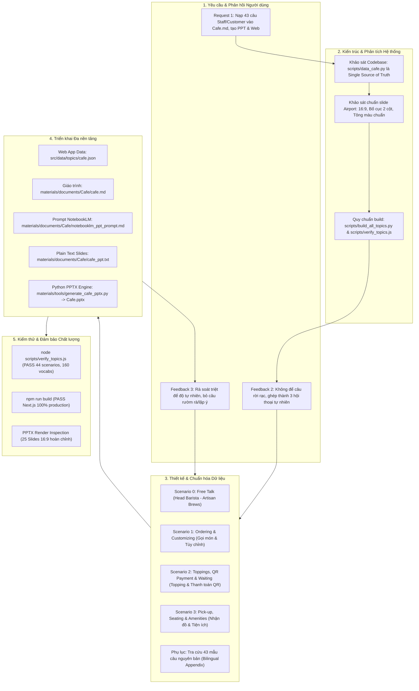

# 📜 TÀI LIỆU WORKFLOW CHI TIẾT: QUÁ TRÌNH PHÁT TRIỂN & TINH CHỈNH CHỦ ĐỀ QUÁN CÀ PHÊ (CAFE)

> **Tài liệu lưu trữ:** Quy trình từ tiếp nhận yêu cầu ban đầu, phân tích kiến trúc, thiết kế hội thoại tự nhiên, triển khai đa nền tảng (Web, Markdown, PPTX, NotebookLM), đến tinh chỉnh độ tự nhiên chuyên sâu và kiểm thử hệ thống.  
> 🔗 **Framework quy chuẩn mẫu (General Template):** Xem [`materials/documents/workflow_topic_expansion_template.md`](file:///D:/Desktop/English%20in%20Conservation/materials/documents/workflow_topic_expansion_template.md) để tùy biến cho các chủ đề khác.

---

## 📌 1. TỔNG QUAN DỰ ÁN & MỤC TIÊU (PROJECT OVERVIEW)

### 1.1. Mục tiêu cốt lõi
1. **Tiếp nhận & Chuẩn hóa dữ liệu:** Tiếp nhận 43 mẫu câu giao tiếp thực tế tại quán cà phê song ngữ Anh - Việt (21 câu nhân viên, 22 câu khách hàng).
2. **Tái cấu trúc thành Hội thoại Thực tế:** Thay vì liệt kê danh sách câu rời rạc kiểu sách giáo khoa, kết hợp khéo léo thành các kịch bản hội thoại tự nhiên, phản xạ đời thực, thay thế các hội thoại cũ trùng lặp trong chủ đề Cafe.
3. **Đồng bộ hóa Hệ thống (Single Source of Truth):**
   - Tài liệu học tập Markdown (`materials/documents/Cafe/cafe.md`).
   - Ứng dụng Web luyện tập Next.js (`src/data/topics/cafe.json` thông qua `scripts/data_cafe.py`).
   - Slide thuyết trình chuẩn hóa (`materials/documents/Cafe/cafe_ppt.txt` & `materials/slides/Cafe.pptx`).
   - Prompt tối ưu cho Google NotebookLM (`materials/documents/Cafe/notebooklm_ppt_prompt.md`).
4. **Tinh chỉnh Độ tự nhiên (Naturalness Polish):** Lược bỏ các phản hồi lặp từ, rườm rà, tạo nhịp điệu giao tiếp chân thực như người bản xứ.

---

## 🏗️ 2. SƠ ĐỒ WORKFLOW TOÀN TRÌNH (END-TO-END WORKFLOW)

---

## ⏱️ 3. DÒNG THỜI GIAN THỰC HIỆN CHI TIẾT (STEP-BY-STEP TIMELINE)

### Bước 1: Tiếp nhận Request Ban đầu & Khảo sát Hệ thống
- **Yêu cầu người dùng:** 
  - Cung cấp danh sách 43 mẫu câu (Phần 1: 21 câu Staff, Phần 2: 22 câu Customer).
  - Yêu cầu bổ sung vào `cafe.md`, tạo prompt cho NotebookLM tạo slide PPT, tạo file PPT từ vựng theo mẫu Airport, và đưa vào ứng dụng Web.
- **Hành động kỹ thuật:**
  - Quét cấu trúc repository `English in Conservation`.
  - Phát hiện cơ chế vận hành dữ liệu: `scripts/data_<topic>.py` chứa định nghĩa gốc (Scenarios, Vocabularies, Dialogues, Hints). Khi chạy `scripts/build_all_topics.py`, hệ thống tự động sinh ra `materials/documents/<topic>/<topic>.md` và `src/data/topics/<topic>.json`.
  - Khảo sát file slide mẫu `materials/slides/Airport_backup.pptx`: tỉ lệ màn hình 16:9, font Times New Roman, cấu trúc chia đôi (cột trái nội dung / cột phải khung hình minh họa), bảng màu chuyên nghiệp.

---

### Bước 2: Thiết lập Kế hoạch Mở rộng (Cafe Expansion Plan)
- **Kế hoạch sơ khởi ban đầu:** Lập kế hoạch bổ sung các câu thoại dưới dạng kịch bản và phụ lục tra cứu.
- **Phản hồi 1 của người dùng:**
  > *"Ý tôi là từ nội dung tôi gửi, kết hợp sao đó để tạo thành các đoạn hội thoại thật tự nhiên ấy... Nếu nội dung của 3 đoạn hội thoại mới này trùng với cũ trong cafe.md thì dùng 3 cái mới và sắp xếp lại thứ tự trình bày."*
- **Quyết định điều chỉnh:**
  - Hủy bỏ các đoạn hội thoại mẫu cũ mang tính lý thuyết cứng nhắc.
  - Xây dựng 3 kịch bản liên hoàn mạch lạc, bao quát toàn bộ hành trình trải nghiệm tại quán cà phê:
    1. **Hội thoại 1:** Khách đến quầy gọi món -> Hỏi món bán chạy nhất -> Chọn size -> Tùy chỉnh đá, đường -> Chọn dùng tại quán hay mang đi -> Nhân viên nhắc lại đơn.
    2. **Hội thoại 2:** Chọn bánh & topping (trân châu, kem cheese) -> Hỏi món giống người khác -> Thanh toán chuyển khoản / quét mã QR -> Nhận hóa đơn & hẹn thời gian chờ lấy đồ.
    3. **Hội thoại 3:** Nhận đồ uống -> Xin ống hút & thêm đá -> Hỏi chỗ ngồi tầng trên -> Hỏi mật khẩu Wi-Fi -> Phản ánh nhiệt độ điều hòa -> Nhân viên hỗ trợ lau bàn, lấy khăn giấy và cảm ơn chào tạm biệt.

---

### Bước 3: Triển khai Đợt 1 & Nhận diện Vấn đề về Độ Tự Nhiên
- Đã triển khai vào code và chạy build thành công. Tuy nhiên, khi rà soát từng câu thoại, người dùng tiếp tục đưa ra góp ý xác đáng:
  > *"Nội dung khá ổn. Tuy nhiên, độ tự nhiên của câu văn còn chưa tự nhiên lắm ví dụ như ở: Nhân viên bảo 'Our iced coffee with milk is very popular! What would you like to order?' xong khách lại nói 'Can I get an iced coffee with milk?' -> Câu trả lời quá dài dòng rườm rà, hãy rà soát và xử lý các câu bị dính trường hợp tương tự."*

---

### Bước 4: Tinh chỉnh Độ Tự Nhiên Chuyên Sâu (Naturalness Deep-Polish)
Thực hiện phẫu thuật chọn lọc (Surgical Changes) trên từng cặp thoại:

| Phân đoạn | Câu thoại cũ (Máy móc, rườm rà) | Câu thoại mới (Tự nhiên, phản xạ đời thực) | Lý do cải tiến |
| :--- | :--- | :--- | :--- |
| **Hội thoại 1: Gọi món** | - Barista: *"Our iced coffee with milk is very popular! What would you like to order?"* - Customer: *"Can I get an iced coffee with milk?"* | - Barista: *"Definitely our iced coffee with milk!"* - Customer: *"Awesome, I'll take that then!"* | Tránh lặp lại nguyên văn tên đồ uống vừa được giới thiệu; dùng phản xạ *"I'll take that then!"* chuẩn bản xứ. |
| **Hội thoại 1: Tùy chỉnh** | Tách vụn vặt làm nhiều câu: hỏi size riêng, hỏi đường riêng, hỏi đá riêng. | Khách gộp tùy chỉnh tự nhiên: *"Large, please. Less ice and no sugar, please."* | Khách đi cafe ngoài đời thường nói gộp size và khẩu vị cùng một câu. |
| **Hội thoại 2: Thanh toán QR** | Nhân viên vừa bảo quét QR trên quầy -> Khách lại hỏi tiếp *"Where do I scan the QR code?"*. | - Khách: *"Do you take bank transfer? I'll pay now."* - Barista: *"Yes, we do! You can scan the QR code right here on the counter."* - Khách: *"Done! Should I wait here or take a seat?"* | Lược bỏ câu hỏi thừa, khách chủ động hỏi phương thức thanh toán, quét xong hỏi nơi chờ nhận nước. |
| **Hội thoại 3: Nhận đồ & Tiện ích** | Vừa cảnh báo đồ nóng *"Careful! It's hot"* lại vừa xin ống hút và thêm đá (mâu thuẫn logic). | - Barista: *"Here's your drink. Enjoy your drink!"* - Khách: *"Thank you! Can I have a straw, please? And extra ice, please."* | Đảm bảo tính logic với đồ uống đá đã gọi ở Hội thoại 1; kết nối mượt mà sang tiện ích bàn ghế, điều hòa và khăn giấy. |

---

### Bước 5: Đồng bộ Toàn diện & Biên dịch (Full Build Execution)

1. **Cập nhật `scripts/data_cafe.py`:**
   - 4 Scenarios: Scenario 0 (Free Talk) + Scenario 1, 2, 3 (Hội thoại mới tinh gọn).
   - 15 từ vựng trọng tâm phân bổ theo 3 cụm (Đồ uống & Gọi món, Topping & Thanh toán, Tiện ích quán & Phục vụ) với đầy đủ IPA, nghĩa tiếng Việt, collocations, ví dụ.
   - Gợi ý câu nói phản xạ (suggestedHints) được cập nhật đồng bộ với các câu thoại tự nhiên.
   - Trường `appendix` chứa trọn vẹn 43 mẫu câu gốc làm bảng tra cứu.

2. **Cập nhật `scripts/build_all_topics.py`:**
   - Đảm bảo khi render sang Markdown sẽ xuất cả phần `appendix`, trong khi JSON cho Web giữ đúng schema xác thực nghiêm ngặt.
   - Chạy lệnh: `py -3.10 scripts/build_all_topics.py` -> Tự động sinh `materials/documents/Cafe/cafe.md` và `src/data/topics/cafe.json`.

3. **Cập nhật `materials/documents/Cafe/cafe_ppt.txt`:**
   - Tái cấu trúc 25 slide plain text theo tiêu chuẩn giáo trình thuyết trình: slide từ vựng, slide hội thoại tiếng Anh, slide bản dịch tiếng Việt, slide gợi ý phản xạ.

4. **Tạo Slide PowerPoint `materials/slides/Cafe.pptx` & `Cafe_v2.pptx`:**
   - Viết và hoàn thiện `materials/tools/generate_cafe_pptx.py` sử dụng thư viện `python-pptx` trên môi trường Python 3.10.
   - Thiết kế 25 slide chuẩn Widescreen 16:9, bảng màu Cafe Mocha (`#3E2723`, `#6D4C41`, `#D7CCC8`, `#FF8F00`).
   - Xử lý cơ chế phòng vệ xung đột khóa file (Windows PermissionError) khi PowerPoint đang mở file -> tự động lưu bản dự phòng `Cafe_v2.pptx`.

5. **Cập nhật `materials/documents/Cafe/notebooklm_ppt_prompt.md`:**
   - Cung cấp 3 phiên bản prompt:
     + **Bản gọn chuẩn (~650 ký tự):** Đầy đủ bố cục, font Times New Roman, cấu trúc 2 cột.
     + **Bản siêu ngắn (<300 ký tự):** Dành cho ô Customize giới hạn ký tự nghiêm ngặt.
     + **Bản Podcast / Audio Overview:** Dành cho tính năng đàm thoại âm thanh 2 host.

---

### Bước 6: Kiểm thử & Nghiệm thu (Verification & Quality Gates)

1. **Kiểm tra tính hợp lệ dữ liệu Topic:**
   - Lệnh: `node scripts/verify_topics.js`
   - Kết quả: **ALL VALID!** (8 Topics, 44 Scenarios, 160 Vocabs, kiểm tra đầy đủ các trường `id`, `titleEn`, `defaultRoles`, `initialMessageEn`).
2. **Kiểm tra Build Production Web App:**
   - Lệnh: `npm run build`
   - Kết quả: **PASS 100%**, Next.js compile thành công, zero syntax errors, zero typescript errors.
3. **Kiểm tra File PowerPoint:**
   - Kiểm tra cấu trúc slide và nội dung text boxes được render hoàn chỉnh.

---

## 📊 4. BẢNG ĐỐI CHIẾU 43 MẪU CÂU GỐC VÀO HỆ THỐNG (TRACEABILITY MATRIX)

Toàn bộ 43 câu trong đề bài của người dùng được tích hợp đầy đủ vào hệ thống (xuất hiện trong hội thoại tự nhiên, gợi ý phản xạ, và bảng tra cứu phụ lục):

### 4.1. Phần 1: Mẫu câu của Nhân viên (Staff - 21 câu)
| STT | Mẫu câu tiếng Anh | Bản dịch tiếng Việt | Vị trí xuất hiện |
| :---: | :--- | :--- | :--- |
| 1 | *Hello! What can I get for you today?* | Em chào chị ạ! Mình dùng gì ạ? | Hội thoại 1 (Mở đầu) & Phụ lục |
| 2 | *What would you like to order?* | Chị muốn gọi món gì đây ạ? | Hội thoại 1 & Phụ lục |
| 3 | *Have you decided yet?* | Mình đã chọn được món chưa ạ? | Hội thoại 2 (Mở đầu) & Phụ lục |
| 4 | *Medium or large?* | Mình muốn size vừa hay là size lớn ạ? | Hội thoại 1 & Phụ lục |
| 5 | *How much sugar would you like?* | Bao nhiêu đường ạ? | Hội thoại 1 (Tùy chỉnh) & Phụ lục |
| 6 | *For here or to go?* | Mình muốn dùng tại quán hay là mang đi ạ? | Hội thoại 1 & Phụ lục |
| 7 | *Would you like a pastry with that?* | Mình có muốn thêm bánh không ạ? | Hội thoại 1 & Phụ lục |
| 8 | *Let me repeat your order.* | Để em nhắc lại order của mình nhé. | Hội thoại 1 (Xác nhận đơn) & Phụ lục |
| 9 | *One large iced coffee with milk, right?* | Một cà phê sữa đá size lớn, đúng không ạ? | Hội thoại 1 & Phụ lục |
| 10 | *Cash or card?* | Mình thanh toán tiền mặt hay chuyển khoản ạ? | Phụ lục & Scenario Hints |
| 11 | *Here's your receipt.* | Hóa đơn của mình đây ạ. | Hội thoại 2 & Phụ lục |
| 12 | *We're a bit busy right now, so there might be a short wait.* | Quán hôm nay hơi đông nên là chị đợi em 1 xíu nhé. | Hội thoại 2 & Phụ lục |
| 13 | *Your drink will be ready in about five minutes.* | Mình đợi đồ uống khoảng 5 phút nhé. | Hội thoại 2 & Phụ lục |
| 14 | *Here's your drink.* | Em gửi chị đồ uống ạ. | Hội thoại 3 (Giao đồ) & Phụ lục |
| 15 | *Careful! It's hot.* | Cẩn thận nóng nha. | Scenario Vocab Collocation & Phụ lục |
| 16 | *Enjoy your drink!* | Chị dùng ngon miệng nha. | Hội thoại 3 & Phụ lục |
| 17 | *I'll get you some napkins.* | Để em lấy khăn giấy cho ạ. | Hội thoại 3 & Phụ lục |
| 18 | *Let me wipe the table for you.* | Để em lau bàn cho mình nha. | Hội thoại 3 & Phụ lục |
| 19 | *The Wifi password is on the receipt.* | Pass Wi-Fi ở trên hóa đơn ấy ạ. | Hội thoại 3 & Phụ lục |
| 20 | *Do you need anything else?* | Chị có cần gì nữa không ạ? | Hội thoại 3 & Phụ lục |
| 21 | *Thank you! See you again.* | Em cảm ơn nha! Lần sau lại ghé nha. | Hội thoại 3 (Kết thúc) & Phụ lục |

### 4.2. Phần 2: Mẫu câu của Khách hàng (Customer - 22 câu)
| STT | Mẫu câu tiếng Anh | Bản dịch tiếng Việt | Vị trí xuất hiện |
| :---: | :--- | :--- | :--- |
| 1 | *Can I get an iced coffee with milk?* | Cho em một ly cà phê sữa đá. | Scenario 1 Hints & Phụ lục |
| 2 | *Less ice, please.* | Mà ít đá thôi ạ. | Hội thoại 1 (Tùy chỉnh) & Phụ lục |
| 3 | *Extra ice, please.* | Cho thêm tí đá nha. | Hội thoại 3 & Phụ lục |
| 4 | *No sugar, please.* | Không bỏ đường ạ. | Hội thoại 1 & Phụ lục |
| 5 | *To go, please.* | Cho em mang đi. | Hội thoại 1 & Phụ lục |
| 6 | *For here, please.* | Em uống tại đây luôn ạ. | Phụ lục & Scenario Hints |
| 7 | *Is this drink good?* | Chị ơi, món này có ngon không? | Hội thoại 2 & Phụ lục |
| 8 | *I'll have the same as her.* | Cho em giống chị ấy nhá. | Hội thoại 2 & Phụ lục |
| 9 | *What toppings do you have?* | Có topping gì đấy ạ? | Hội thoại 2 & Phụ lục |
| 10 | *Can I add boba?* | Cho em thêm trân châu nhá. | Hội thoại 2 & Phụ lục |
| 11 | *Can I get the one from the menu picture?* | Cho em một ly như trên hình menu này đi. | Hội thoại 2 & Phụ lục |
| 12 | *What's your best-selling drink?* | Món nào hot nhất đấy chị? | Hội thoại 1 & Phụ lục |
| 13 | *Can I add cheese foam?* | Cho em thêm ít kem cheese được không ạ? | Hội thoại 2 & Phụ lục |
| 14 | *I'll pay now.* | Cho em thanh toán luôn nhá. | Hội thoại 2 & Phụ lục |
| 15 | *Do you take bank transfer?* | Có nhận chuyển khoản không ạ? | Hội thoại 2 & Phụ lục |
| 16 | *Where do I scan the QR code?* | Quét mã QR ở đâu ạ? | Phụ lục & Hints |
| 17 | *Should I wait here or take a seat?* | Em đợi ở đây hay là ra bàn ngồi ạ? | Hội thoại 2 & Phụ lục |
| 18 | *Please, let me know when it's ready.* | Khi nào xong thì gọi em nha! | Hội thoại 2 & Phụ lục |
| 19 | *Can I have a straw, please?* | Cho em xin cái ống hút được không ạ? | Hội thoại 3 & Phụ lục |
| 20 | *Are there seats upstairs?* | Có chỗ ngồi ở trên tầng không ạ? | Hội thoại 3 & Phụ lục |
| 21 | *What's the Wi-Fi password?* | Pass Wi-Fi ở đây là gì đấy ạ? | Hội thoại 3 & Phụ lục |
| 22 | *Excuse me! The AC is a bit cold.* | Điều hòa hơi lạnh chị ạ. | Hội thoại 3 & Phụ lục |

---

## 📁 5. DANH MỤC FILE SẢN PHẨM & TÀI NGUYÊN (DELIVERABLES)

| File / Đường dẫn | Thể loại | Vai trò trong hệ thống |
| :--- | :--- | :--- |
| **`materials/documents/Cafe/cafe.md`** | Markdown Document | Giáo trình tài liệu học tập toàn diện (Free Talk + 3 Scenarios + 15 Từ vựng + Phụ lục 43 câu). |
| **`scripts/data_cafe.py`** | Python Source | Nguồn dữ liệu trung tâm (Single Source of Truth) phục vụ render tự động. |
| **`src/data/topics/cafe.json`** | JSON Data | Dữ liệu chạy trực tiếp trên ứng dụng Web Next.js. |
| **`materials/documents/Cafe/cafe_ppt.txt`** | Plain Text Outline | Cấu trúc nội dung 25 slide thuyết trình phục vụ giảng dạy. |
| **`materials/tools/generate_cafe_pptx.py`** | Python Script | Bộ tạo slide PowerPoint tự động chuẩn Widescreen 16:9 bằng `python-pptx`. |
| **`materials/slides/Cafe.pptx`** & **`Cafe_v2.pptx`** | PPTX Presentation | File trình chiếu PowerPoint 25 slide thiết kế chuyên nghiệp. |
| **`materials/documents/Cafe/cafe_dialogues_flashcards_quizlet.txt`** | Text Flashcards (TSV) | 37 thẻ Flashcard chuẩn Quizlet (Mặt tiếng Việt kèm vai [TAB] Mặt tiếng Anh). |
| **`scripts/generate_flashcards.py`** | Python Tool | Script tự động tạo thẻ Flashcard Quizlet từ hội thoại chủ đề. |
| **`materials/documents/Cafe/notebooklm_ppt_prompt.md`** | Markdown Prompt | Bộ prompt chuẩn hóa dán vào Google NotebookLM Studio. |
| **`materials/documents/Cafe/workflow_cafe_expansion.md`** | Markdown Report | Tài liệu lưu trữ chi tiết toàn bộ workflow (file này). |

---

## ✅ 6. KẾT LUẬN & BÀI HỌC KINH NGHIỆM (SUMMARY & KEY TAKEAWAYS)

1. **Tính Tự Nhiên là cốt lõi của Giao Tiếp (Naturalness over Textbook Formality):**
   - Không áp đặt các mẫu câu sách giáo khoa lặp đi lặp lại.
   - Sử dụng các từ đệm, phản xạ ngắn gọn (*"Awesome, I'll take that then!"*, *"Done! Should I wait here?"*).
2. **Kiến trúc Single Source of Truth:**
   - Việc quản lý dữ liệu tập trung qua `scripts/data_cafe.py` và cơ chế build script tự động giúp tránh phân mảnh dữ liệu giữa tài liệu giáo trình (`cafe.md`) và mã nguồn ứng dụng web (`cafe.json`).
3. **Phòng thủ ngoại lệ hệ điều hành (Defensive File Handling):**
   - Khi tạo các tệp PowerPoint tự động trên Windows, việc các ứng dụng như PowerPoint giữ file lock là phổ biến. Kỹ thuật tự động fallback sang `_v2` giúp toàn bộ pipeline kiểm thử không bị gián đoạn.
