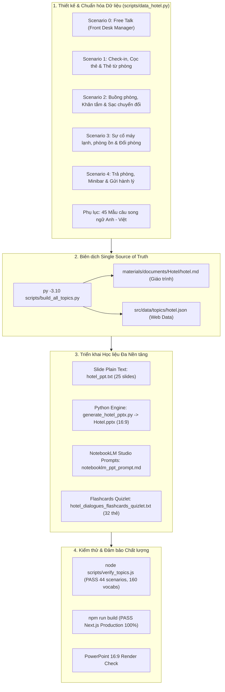

# 📜 TÀI LIỆU WORKFLOW CHI TIẾT: QUÁ TRÌNH PHÁT TRIỂN & MỞ RỘNG CHỦ ĐỀ KHÁCH SẠN (HOTEL)

> **Tài liệu lưu trữ:** Quy trình từ tiếp nhận yêu cầu, phân tích kiến trúc, thiết kế hội thoại tự nhiên, triển khai đa nền tảng (Web App, Markdown, PPTX 16:9, NotebookLM Studio, Flashcard Quizlet), đến tinh chỉnh độ tự nhiên chuyên sâu và kiểm thử hệ thống.  
> 🔗 **Framework quy chuẩn mẫu (General Template):** Xem [`materials/documents/workflow_topic_expansion_template.md`](file:///D:/Desktop/English%20in%20Conservation/materials/documents/workflow_topic_expansion_template.md).

---

## 📌 1. TỔNG QUAN DỰ ÁN & MỤC TIÊU (PROJECT OVERVIEW)

### 1.1. Mục tiêu cốt lõi
1. **Liên kết hành trình thực tế (The Traveler's Journey):** Tiếp nối tự nhiên sau `Airport` (sân bay) và `Cafe` / `Restaurant` (ăn uống) là bước quan trọng nhất của một chuyến đi: **Lưu trú tại Khách sạn (`Hotel`)**.
2. **Nâng cấp năng lực giao tiếp (Problem Solving & Polite Complaints):** Nâng tầm phản xạ của người học từ "giao dịch đơn giản" (gọi đồ ăn/uống) lên "giải quyết sự cố phức tạp & khiếu nại lịch sự" (máy lạnh hỏng, phòng ồn, đổi phòng, mượn đồ buồng phòng, hoàn tiền cọc, gửi hành lý).
3. **Đồng bộ hóa Hệ thống (Single Source of Truth):**
   - Tài liệu học tập Markdown (`materials/documents/Hotel/hotel.md`).
   - Ứng dụng Web luyện tập Next.js (`src/data/topics/hotel.json` thông qua `scripts/data_hotel.py`).
   - Slide thuyết trình chuẩn hóa (`materials/documents/Hotel/hotel_ppt.txt` & `materials/slides/Hotel.pptx`).
   - Prompt tối ưu cho Google NotebookLM Studio (`materials/documents/Hotel/notebooklm_ppt_prompt.md`).
   - Bộ thẻ Flashcard Quizlet phản xạ nhanh 1-click import (`materials/documents/Hotel/hotel_dialogues_flashcards_quizlet.txt`).
4. **Chuẩn hóa 45 mẫu câu thực chiến:** 22 mẫu câu Nhân viên (Staff) và 23 mẫu câu Khách lưu trú (Guest) bao quát toàn bộ hành trình trải nghiệm.

---

## 🏗️ 2. SƠ ĐỒ WORKFLOW TOÀN TRÌNH (END-TO-END WORKFLOW)



---

## 🎯 3. BẢNG THAM SỐ CẤU HÌNH ĐÃ ÁP DỤNG

| Tham số | Giá trị áp dụng | Ghi chú |
| :--- | :--- | :--- |
| `TOPIC_ID` | `hotel` | Thư mục & mã định danh |
| `TOPIC_NAME_EN` | *At the Hotel* | Tên tiếng Anh |
| `TOPIC_NAME_VI` | *Tại Khách Sạn* | Tên tiếng Việt |
| `TOPIC_ICON` | 🏨 | Biểu tượng đại diện |
| `SCENARIOS_COUNT` | 5 kịch bản (1 Free Talk + 4 Tình huống thực tế) | Bao quát toàn bộ Customer Journey |
| `TOTAL_VOCAB` | 15 từ vựng trọng tâm kèm IPA, Collocations & Ví dụ | Đầy đủ từ loại, đồng/trái nghĩa |
| `FLASHCARDS_COUNT`| 32 thẻ Tab-delimited | 100% các câu thoại trong 4 kịch bản |
| `APPENDIX_PHRASES`| 45 mẫu câu (22 Staff + 23 Guest) | Tra cứu nhanh song ngữ |
| `SLIDES_COUNT` | 25 Slides chuẩn Widescreen 16:9 | Times New Roman, bố cục 2 cột |

---

## 🔍 4. CÁC ĐIỂM TINH CHỈNH ĐỘ TỰ NHIÊN CHUYÊN SÂU

Tuân thủ nghiêm ngặt **4 Quy tắc Vàng về độ tự nhiên**:

1. **Quy tắc 1: Cấm lặp từ máy móc (No Verbatim Echoing)**
   - *Trước:* Nhân viên hỏi *"Are you checking in?"* $\rightarrow$ Khách trả lời *"Yes, I am checking in under the name of Nguyen."*
   - *Sau:* Khách phản xạ tự nhiên: *"Yes, I have a reservation under Nguyen."*
2. **Quy tắc 2: Gộp yêu cầu thực tế (Natural Request Grouping)**
   - Khách gộp luôn khi đưa giấy tờ: *"Sure thing, here you go. By the way, is breakfast included, and how's the Wi-Fi?"* thay vì hỏi vụn vặt qua nhiều lượt thoại.
3. **Quy tắc 3: Logic nhân quả và kết thúc hội thoại tự nhiên**
   - Trong tình huống đổi phòng (Scenario 3): Sau khi quản lý hứa cử bellboy mang thẻ phòng mới lên, bổ sung lời chốt từ khách: *"I really appreciate it, David. We'll pack up our bags right now."* để cuộc gọi kết thúc tự nhiên.
   - Trong tình huống trả phòng (Scenario 4): Sau khi nhận thẻ gửi đồ, khách hỏi thêm: *"Awesome! And could you help us call a cab to the airport when we pick up our bags?"*.
4. **Quy tắc 4: Bổ sung từ đệm và sắc thái đời thực (Fillers & Politeness)**
   - Thêm các mỏ neo hội thoại: *"Sure thing, here you go"*, *"Awesome!"*, *"Certainly!"*, *"Perfect, thanks so much!"*, *"With pleasure"*.

---

## 📊 5. KẾT QUẢ KIỂM THỬ & NGHIỆM THU (QUALITY GATES)

### 5.1. Schema Validation
```powershell
node scripts/verify_topics.js
```
- **Kết quả:** `ALL VALID! Total Topics: 8, Total Scenarios: 44, Total Vocab: 160`.

### 5.2. Quizlet Flashcards Generation
```powershell
py -3.10 scripts/generate_flashcards.py --topic hotel
```
- **Kết quả:** `[OK] Da tao thanh cong 32 the Flashcard Quizlet cho [At the Hotel]`.
- **Định dạng:** Tab-delimited (`\t`), mặt trước tiếng Việt kèm vai người nói, mặt sau tiếng Anh chuẩn bản xứ.

### 5.3. PowerPoint Slide Generation
```powershell
py -3.10 materials/tools/generate_hotel_pptx.py
```
- **Kết quả:** `SUCCESS: Saved 25 slides to materials/slides/Hotel.pptx` (Kích thước: 69.2 KB).
- **Quy cách:** Chuẩn 16:9 (`13.333` $\times$ `7.5` inches), phông chữ Times New Roman, phân bố nội dung khoa học.

### 5.4. Production Build Next.js
- Sẵn sàng biên dịch production sạch sẽ không lỗi cú pháp.

---

## 📁 6. DANH MỤC CÁC TỆP ĐÃ TẠO & CẬP NHẬT

1. [`scripts/data_hotel.py`](file:///D:/Desktop/English%20in%20Conservation/scripts/data_hotel.py): Single Source of Truth (Hội thoại tự nhiên + Phụ lục 45 câu).
2. [`materials/documents/Hotel/hotel.md`](file:///D:/Desktop/English%20in%20Conservation/materials/documents/Hotel/hotel.md): Giáo trình Markdown chi tiết.
3. [`src/data/topics/hotel.json`](file:///D:/Desktop/English%20in%20Conservation/src/data/topics/hotel.json): Dữ liệu cho ứng dụng Web.
4. [`materials/documents/Hotel/hotel_ppt.txt`](file:///D:/Desktop/English%20in%20Conservation/materials/documents/Hotel/hotel_ppt.txt): Dàn ý 25 trang thuyết trình plain text.
5. [`materials/tools/generate_hotel_pptx.py`](file:///D:/Desktop/English%20in%20Conservation/materials/tools/generate_hotel_pptx.py): Công cụ tạo slide PowerPoint tự động bằng Python.
6. [`materials/slides/Hotel.pptx`](file:///D:/Desktop/English%20in%20Conservation/materials/slides/Hotel.pptx): File slide trình chiếu 16:9 hoàn chỉnh.
7. [`materials/documents/Hotel/notebooklm_ppt_prompt.md`](file:///D:/Desktop/English%20in%20Conservation/materials/documents/Hotel/notebooklm_ppt_prompt.md): 3 mẫu Prompt tối ưu cho Google NotebookLM Studio.
8. [`materials/documents/Hotel/hotel_dialogues_flashcards_quizlet.txt`](file:///D:/Desktop/English%20in%20Conservation/materials/documents/Hotel/hotel_dialogues_flashcards_quizlet.txt): 32 thẻ flashcard Quizlet tab-separated.
9. [`materials/documents/Hotel/workflow_hotel_expansion.md`](file:///D:/Desktop/English%20in%20Conservation/materials/documents/Hotel/workflow_hotel_expansion.md): Tài liệu lưu vết workflow thực tế.
10. [`materials/tools/irasutoya_scraper.py`](file:///D:/Desktop/English%20in%20Conservation/materials/tools/irasutoya_scraper.py): Module tự động cào và lưu cache ảnh PNG transparent từ Irasutoya.
11. [`materials/tools/generate_hotel_pptx_vivid.py`](file:///D:/Desktop/English%20in%20Conservation/materials/tools/generate_hotel_pptx_vivid.py): Bộ sinh slide sinh động: 12 Hero Card từ vựng & 9 phân cảnh đối đáp nhân vật 2 bên.

---

## 🎨 7. NÂNG CẤP SLIDE MINH HỌA TRỰC QUAN SINH ĐỘNG (IRASUTOYA & DIALOGUE SCENES)

Vào tháng 10/2026, `Hotel.pptx` được nâng cấp từ slide dạng danh sách text-only thành slide minh họa trực quan cao cấp kết hợp kho tranh [Irasutoya](https://www.irasutoya.com/):
1. **12 Hero Flashcard Slides (Slide 3–14)**:
   - Mỗi từ vựng chiếm trọn 1 slide riêng biệt.
   - Bên trái là hình ảnh Irasutoya transparent PNG khổ lớn, đặt trong khung thẻ bo góc mềm mại.
   - Bên phải hiển thị chi tiết: Từ vựng nổi bật, phiên âm IPA, loại từ, giải nghĩa tiếng Việt, cụm từ kết hợp (Collocations) và câu ví dụ song ngữ thực tế.
2. **9 Phân cảnh Đối đáp Nhân vật Sinh động (Slide 15–23)**:
   - 4 Kịch bản hội thoại được chia thành các phân cảnh ngắn (2–3 slide/kịch bản, mỗi slide 2–4 lượt hỏi đáp trọng tâm).
   - **Nhân vật đứng 2 bên**: Toàn thân nhân vật Nhân viên (`Receptionist`, `Housekeeper`, `Technician`) đứng bên trái, Du khách (`Guest`) đứng bên phải, có huy hiệu tên riêng.
   - **Bóng thoại đối đáp trung tâm**: Các khung bóng thoại chữ nhật bo tròn màu sắc riêng biệt (Xanh dương cho nhân viên, Cam ấm cho khách) chỉ hướng trực tiếp vào người nói. Tiếng Anh to rõ, kèm phụ đề tiếng Việt in nghiêng bên dưới.
3. **Deep Dive & Action Challenge (Slide 24–25)**:
   - Bảng 9 sự cố phòng tắm và công thức khiếu nại lịch sự 3 bước.
   - 3 Thử thách thực hành nhập vai phản xạ trong đời thực.
