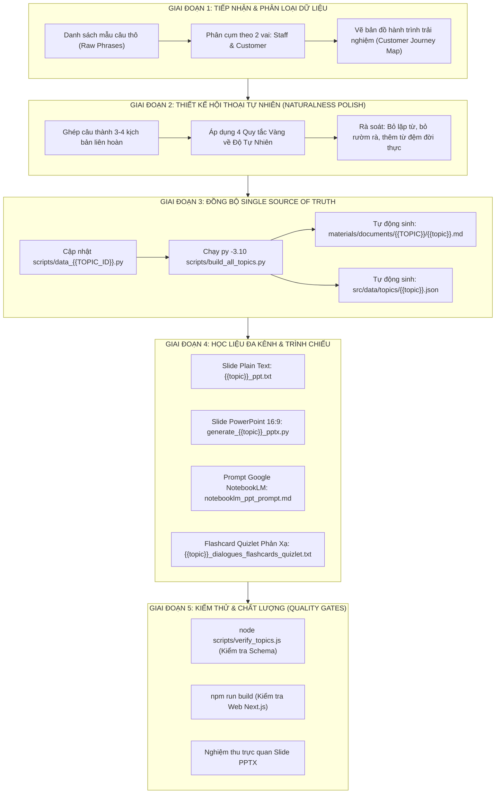

# 📐 FRAMEWORK & QUY TRÌNH CHUẨN (SOP): MỞ RỘNG CHỦ ĐỀ GIAO TIẾP & TINH CHỈNH ĐỘ TỰ NHIÊN

> **Mục đích tài liệu:** Khung quy trình tổng quát (General Template) dùng để chuẩn hóa, mở rộng bất kỳ chủ đề giao tiếp nào (`Cafe`, `Airport`, `Hotel`, `Restaurant`, `Shopping`, `Transportation`, `Workplace`, v.v.) từ danh sách câu thoại thô thành hệ sinh thái học tập hoàn chỉnh: **Hội thoại Tự nhiên $\rightarrow$ Web App $\rightarrow$ Giáo trình Markdown $\rightarrow$ Slide PowerPoint $\rightarrow$ Prompt NotebookLM.**

---

## ⚙️ 1. BẢNG THAM SỐ CẤU HÌNH (CONFIGURATION PARAMETERS)
*Điền các thông số tương ứng với chủ đề bạn đang phát triển vào bảng dưới đây:*

| Tham số (Variable) | Ví dụ minh họa | Mô tả cấu hình |
| :--- | :--- | :--- |
| `{{TOPIC_ID}}` | `cafe` / `hotel` / `restaurant` | Mã định danh thư mục và tệp code (viết thường, viết liền) |
| `{{TOPIC_NAME_EN}}` | *At the Cafe & Coffee Shop* | Tên chủ đề hiển thị bằng tiếng Anh |
| `{{TOPIC_NAME_VI}}` | *Tại Quán Cà Phê* | Tên chủ đề hiển thị bằng tiếng Việt |
| `{{TOPIC_ICON}}` | ☕ / 🏨 / 🍽️ / ✈️ | Icon đại diện của chủ đề |
| `{{ROLE_AI_NAME}}` | Barista / Receptionist / Waiter | Tên vai diễn của AI phản hồi |
| `{{ROLE_AI_TITLE}}` | Head Barista / Front Desk Staff | Chức danh hiển thị của AI |
| `{{ROLE_USER_NAME}}` | Customer / Guest / Traveler | Tên vai diễn của người học |
| `{{ROLE_USER_TITLE}}` | Khách hàng / Khách lưu trú (Bạn) | Chức danh hiển thị của người học |
| `{{SCENARIOS_COUNT}}` | 3 - 4 tình huống | Số lượng tình huống theo hành trình trải nghiệm |
| `{{TOTAL_VOCAB}}` | 15 - 20 từ vựng trọng tâm | Số lượng từ vựng cốt lõi kèm IPA, collocations, ví dụ |

---

## 🔄 2. SƠ ĐỒ WORKFLOW TỔNG QUÁT (PIPELINE FLOWCHART)



---

## 📝 3. HƯỚNG DẪN 5 BƯỚC THỰC THI CHI TIẾT (STEP-BY-STEP SOP)

### 🔹 BƯỚC 1: Thu Thập & Phân Tích Hành Trình Khách Hàng (Customer Journey)
1. **Thu thập dữ liệu thô:**
   - Liệt kê toàn bộ các câu giao tiếp thực tế cần học (chia rõ: Phía Nhân viên phục vụ vs Phía Khách hàng).
2. **Thiết lập hành trình trải nghiệm chuẩn (Chuỗi 3-4 kịch bản):**
   - *Scenario 0 (Free Talk):* Không giới hạn, AI vào vai quản lý/chuyên gia, mở rộng ngữ cảnh tự do.
   - *Scenario 1 (Tiếp cận & Bắt đầu):* Chào hỏi $\rightarrow$ Hỏi nhu cầu $\rightarrow$ Lựa chọn cơ bản.
   - *Scenario 2 (Chi tiết & Thanh toán):* Tùy chỉnh khẩu vị / dịch vụ cộng thêm $\rightarrow$ Hỏi giá $\rightarrow$ Phương thức thanh toán (Tiền mặt / Chuyển khoản QR).
   - *Scenario 3 (Nhận bàn giao / Tiện ích / Chăm sóc sau bán):* Nhận đồ/phòng/dịch vụ $\rightarrow$ Yêu cầu phụ trợ (Wi-Fi, vị trí, nhiệt độ) $\rightarrow$ Cảm ơn & chào tạm biệt.

---

### 🔹 BƯỚC 2: Tinh Chỉnh Độ Tự Nhiên Của Câu Thoại (Naturalness Rules)
> [!IMPORTANT]
> **4 QUY TẮC VÀNG BẮT BUỘC TUÂN THỦ ĐỂ TRÁNH CÂU THOẠI MÁY MÓC:**

1. **Quy tắc 1: Cấm nhắc lại nguyên văn (No Verbatim Echoing)**
   - ❌ *Không tự nhiên:*
     - A: *"Our iced coffee is our best seller. What would you like?"*
     - B: *"Can I get an iced coffee?"* (Lặp từ cứng nhắc).
   - ✅ *Tự nhiên chuẩn bản xứ:*
     - A: *"Definitely our iced coffee!"*
     - B: *"Awesome, I'll take that then!"* hoặc *"Sounds great, give me one of those!"*

2. **Quy tắc 2: Gộp yêu cầu có liên quan (Natural Request Grouping)**
   - ❌ *Không tự nhiên:* Hỏi vụn vặt 4 lượt (hỏi size $\rightarrow$ trả lời $\rightarrow$ hỏi đường $\rightarrow$ trả lời $\rightarrow$ hỏi đá $\rightarrow$ trả lời).
   - ✅ *Tự nhiên chuẩn bản xứ:* Khách gộp luôn khi chọn: *"Large, please. Less ice and no sugar, please."*

3. **Quy tắc 3: Logic ngữ cảnh chặt chẽ (Situational Logic & Cause-Effect)**
   - ❌ *Không tự nhiên:* Nhân viên vừa bảo *"Quét mã QR ngay trên quầy này"* thì khách lại hỏi tiếp *"Quét mã QR ở đâu ạ?"*.
   - ✅ *Tự nhiên chuẩn bản xứ:*
     - Khách: *"Do you take bank transfer? I'll pay now."*
     - Nhân viên: *"Yes, we do! You can scan the QR code right here on the counter."*
     - Khách: *"Done! Should I wait here or take a seat?"*

4. **Quy tắc 4: Bổ sung từ đệm và sắc thái giao tiếp đời thực (Colloquial Fillers & Politeness)**
   - Khéo léo thêm: *"Awesome"*, *"Sure thing"*, *"Done!"*, *"Excuse me!"*, *"No, that's perfect. Thank you!"*.

---

### 🔹 BƯỚC 3: Đồng Bộ Vào Mã Nguồn (Single Source of Truth Pattern)
Hệ thống sử dụng file Python trong thư mục `scripts/` làm gốc. Không chỉnh sửa thủ công file `.json` hoặc `.md`.

1. **Chỉnh sửa file nguồn:** `scripts/data_{{TOPIC_ID}}.py`
   - Cấu trúc chuẩn:
   ```python
   TOPIC_DATA = {
       "id": "{{TOPIC_ID}}",
       "titleEn": "{{TOPIC_NAME_EN}}",
       "titleVi": "{{TOPIC_NAME_VI}}",
       "icon": "{{TOPIC_ICON}}",
       "description": "...",
       "scenarios": [
           {
               "id": "{{TOPIC_ID}}-free-talk",
               "titleEn": "{{TOPIC_NAME_EN}} Free Talk",
               "titleVi": "Thực chiến tự do",
               "situation": "...",
               "defaultRoles": { ... },
               "initialMessageEn": "...",
               "initialMessageVi": "...",
               "suggestedHints": [ ... ]
           },
           {
               "id": "{{TOPIC_ID}}-s1",
               "titleEn": "...",
               "titleVi": "...",
               "situation": "...",
               "defaultRoles": { ... },
               "initialMessageEn": "...",
               "initialMessageVi": "...",
               "vocabulary": [
                   {
                       "id": "vocab-1",
                       "word": "...",
                       "partOfSpeech": "n / v / adj",
                       "ipa": "/.../",
                       "meaningVi": "...",
                       "synonyms": [...],
                       "antonyms": [...],
                       "collocations": [...],
                       "exampleEn": "...",
                       "exampleVi": "..."
                   }
               ],
               "sampleDialogue": [
                   {"speaker": "ai", "roleName": "...", "textEn": "...", "textVi": "..."},
                   {"speaker": "user", "roleName": "...", "textEn": "...", "textVi": "..."}
               ],
               "suggestedHints": [ ... ]
           }
       ],
       "appendix": """## 📋 PHỤ LỤC TRA CỨU MẪU CÂU (ANH - VIỆT) ..."""
   }
   ```

2. **Chạy lệnh đồng bộ tự động:**
   ```powershell
   py -3.10 scripts/build_all_topics.py
   ```
   *Lệnh này tự động cập nhật đồng thời file Markdown giáo trình và file JSON cho Web App.*

---

### 🔹 BƯỚC 4: Tạo Học Liệu Thuyết Trình Đa Kênh

1. **Slide Plain Text (`materials/documents/{{TOPIC}}/{{topic}}_ppt.txt`):**
   - Định dạng chia rõ: `[SLIDE 1: COVER]`, `[SLIDE 2: AGENDA]`, `[SLIDE 3-5: VOCABULARY]`, `[SLIDE 6: DIALOGUE EN]`, `[SLIDE 7: DIALOGUE VI]`, `[SLIDE 8: HINTS]`.

2. **Bộ tạo PowerPoint tự động (`materials/tools/generate_{{topic}}_pptx.py`):**
   - Kích thước: Widescreen 16:9 (`slide_width = 13.333 inches`, `slide_height = 7.5 inches`).
   - Font đồng bộ: `Times New Roman`.
   - Layout 2 cột: Cột trái nội dung song ngữ, cột phải placeholder hình ảnh minh họa thực tế.
   - Cơ chế phòng thủ: Tự động lưu `_v2.pptx` nếu file chính đang bị mở bởi ứng dụng PowerPoint.

3. **Prompt NotebookLM Studio (`materials/documents/{{TOPIC}}/notebooklm_ppt_prompt.md`):**
   - **Bản Gọn Chuẩn (~650 ký tự):** Dành cho ô Customize Studio Slide Deck.
   - **Bản Siêu Ngắn (<300 ký tự):** Dành cho trường hợp giới hạn nghiêm ngặt.
   - **Bản Audio Overview / Podcast:** Dành cho 2 Host AI trò chuyện về bài học.

4. **Bộ Flashcard Quizlet Phản Xạ (`materials/documents/{{TOPIC}}/{{topic}}_dialogues_flashcards_quizlet.txt`):**
   - **Lệnh tự động:** `py -3.10 scripts/generate_flashcards.py --topic {{topic_id}}`
   - **Nội dung:** Toàn bộ các câu thoại trong tất cả các kịch bản hội thoại thực tế của chủ đề.
   - **Định dạng chuẩn để import Quizlet:**
     + Mặt trước (Term): Tiếng Việt kèm vai người nói (Ví dụ: `[Nhân viên] Em chào chị ạ! Mình dùng gì ạ?`)
     + Ký tự phân tách: `[TAB]` (`\t`)
     + Mặt sau (Definition): Tiếng Anh kèm vai người nói (Ví dụ: `[Barista] Hello! What can I get for you today?`)
     + Phân tách mỗi thẻ: Dấu xuống dòng (`\n`)
   - **Cách import vào Quizlet:** Mở Quizlet $\rightarrow$ Tạo học phần mới $\rightarrow$ Bấm "Nhập từ Word, Excel, Google Docs..." $\rightarrow$ Dán toàn bộ nội dung file $\rightarrow$ Chọn phân tách giữa Thuật ngữ và Định nghĩa là `Tab`, giữa các hàng là `Dòng mới` $\rightarrow$ Bấm Nhập.

---

### 🔹 BƯỚC 5: Tiêu Chuẩn Kiểm Thử & Nghiệm Thu (Quality Gates)

Trước khi coi công việc hoàn thành, bắt buộc chạy 2 kiểm thử tự động sau:

```powershell
# 1. Kiểm tra tính toàn vẹn Schema của dữ liệu topics
node scripts/verify_topics.js

# 2. Kiểm tra biên dịch Production Web App Next.js
npm run build
```

**Tiêu chí thành công:**
- `verify_topics.js`: Thông báo `ALL VALID! Total Topics: 8, Total Scenarios: ..., Total Vocab: ...`.
- `npm run build`: Exit code 0, không có lỗi TypeScript, không có lỗi cú pháp.
- File `.pptx` mở bình thường, không lỗi layout tràn chữ.

---

## 📋 4. BẢNG CHECKLIST TỰ ĐÁNH GIÁ (SELF-EVALUATION CHECKLIST)

Dùng checklist này để rà soát trước khi bàn giao:

- [ ] **Độ tự nhiên:** Đã xóa bỏ các câu lặp lại nguyên văn giữa 2 nhân vật chưa?
- [ ] **Nhịp điệu:** Khách hàng có dùng phản xạ ngắn gọn (*"Awesome"*, *"Done!"*, *"I'll take that"*) không?
- [ ] **Đầy đủ dữ liệu:** 100% mẫu câu thô ban đầu có xuất hiện trong hội thoại hoặc phụ lục tra cứu chưa?
- [ ] **Từ vựng:** Các từ vựng cốt lõi có đủ IPA, từ loại, nghĩa tiếng Việt, collocations và câu ví dụ chưa?
- [ ] **Đồng bộ:** Dữ liệu web (`.json`) và tài liệu học (`.md`) có khớp nhau hoàn toàn qua build script không?
- [ ] **Trình chiếu:** File slide plain-text và `.pptx` đã được xuất đủ 25 trang chưa?
- [ ] **Flashcard Quizlet:** Đã chạy sinh file `{{topic}}_dialogues_flashcards_quizlet.txt` chuẩn định dạng Tab-delimited với 100% câu thoại chưa?
- [ ] **Build:** Đã chạy `verify_topics.js` và `npm run build` đạt kết quả xanh (Green) chưa?

---

## 💡 5. VÍ DỤ MINH HỌA ÁP DỤNG THỰC TẾ (CASE STUDY THAM CHIẾU)

Để xem ví dụ triển khai đầy đủ của quy trình này trên thực tế, tham khảo bộ tài liệu mẫu của chủ đề **Cafe**:
- 📄 Tài liệu chi tiết: [`materials/documents/Cafe/cafe.md`](file:///D:/Desktop/English%20in%20Conservation/materials/documents/Cafe/cafe.md)
- 📝 File lưu vết thực tế: [`materials/documents/Cafe/workflow_cafe_expansion.md`](file:///D:/Desktop/English%20in%20Conservation/materials/documents/Cafe/workflow_cafe_expansion.md)
- 📊 Dữ liệu mã nguồn: [`scripts/data_cafe.py`](file:///D:/Desktop/English%20in%20Conservation/scripts/data_cafe.py)
- 🖥️ Slide mẫu: [`materials/slides/Cafe.pptx`](file:///D:/Desktop/English%20in%20Conservation/materials/slides/Cafe.pptx)
